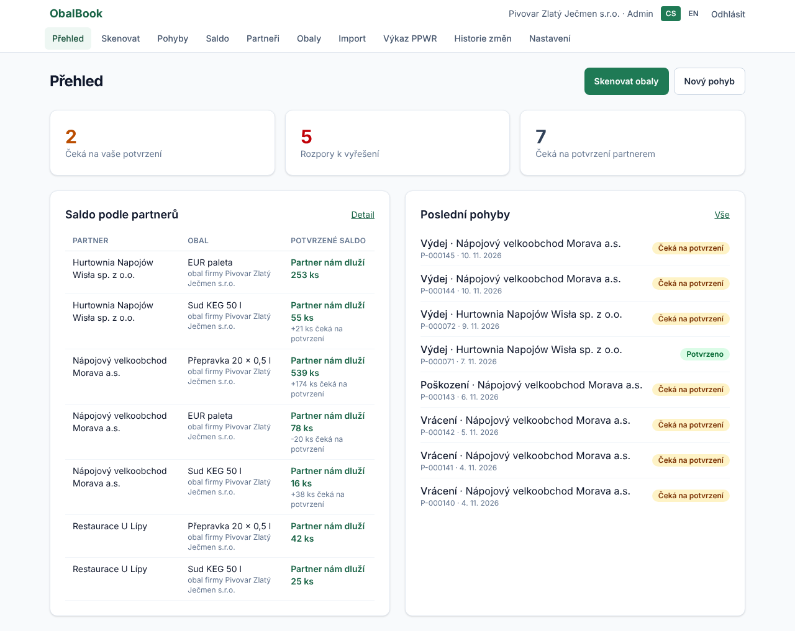

# ObalBook – sdílená evidence vratných obalů mezi firmami

ObalBook **nenahrazuje ERP**. Je to sdílená kniha vratných obalů (palety, přepravky, sudy, IBC…) mezi firmami: odesílatel zapíše výdej, příjemce ho potvrdí nebo rozporuje, obě strany vidí **stejné saldo** a z dat vznikne orientační **výkaz PPWR** (nařízení EU o obalech, čl. 29–31).

Uživatelé: **skladník** (telefon – skenování QR), **logistik** (počítač), **partnerská firma** (vlastní registrace zdarma, nebo jednorázové odkazy v e-mailu bez registrace). Rozhraní česky a anglicky, polština připravená v `messages/pl.json`.



## Funkce

| Oblast | Co umí |
|---|---|
| Firmy a uživatelé | registrace firmy magic linkem, pozvání kolegů, role `admin` / `logistik` / `sklad` |
| Partneři | pozvání e-mailem, partner se zaregistruje zdarma nebo potvrzuje přes jednorázové odkazy |
| Typy obalů | název, kód, materiál, hmotnost, kauce Kč/EUR, vratný ano/ne, QR štítky |
| Pohyby | výdej, příjem, vrácení, ztráta, poškození, úprava salda; stav navržen → potvrzen / rozporován; rozpor řeší obě strany dohodou (protinávrhy, schválení) |
| Saldo | po partnerech a typech, jen z potvrzených pohybů, zvlášť „čeká na potvrzení“, saldo ke dni, hodnota kaucí |
| Mobil | `/scan`: QR partnera a obalu kamerou telefonu (nebo fotoaparátem – QR jsou běžné URL), počty, uložit |
| Import / export | CSV import z ERP s mapováním sloupců a kontrolou (vše, nebo nic); export salda, pohybů a výkazu (středník, UTF-8 BOM pro Excel) |
| Výkaz PPWR | podíl vratných obalů v kusech i kg, obrátky podle typu – **orientační**, celá metodika v `src/lib/ppwr.ts` |
| Upozornění | nepotvrzený pohyb starší 3 dnů, nový rozpor, saldo nad limitem |
| Audit | každá změna s uživatelem a časem, nic se nemaže |

Snímky hlavních toků jsou v [`docs/screenshots`](docs/screenshots), video celého toku v [`docs/video/hlavni-tok.webm`](docs/video/hlavni-tok.webm) (generuje Playwright test `tests/e2e/m7-seed-flow.spec.ts`).

## Technologie

Next.js 15 (App Router) + TypeScript + Tailwind 4 · PostgreSQL + Prisma 6 · Auth.js (magic link, databázové sessions) · e-maily přes Resend nebo SMTP (v dev do konzole) · Vitest (logika, oddělení dat) · Playwright (toky v prohlížeči, desktop i mobil).

## Spuštění lokálně

Potřeba: Node.js 20+ (testováno na 22), Docker (nebo vlastní PostgreSQL 16).

```bash
# 1) databáze (vytvoří i testovací DB obalbook_test)
docker compose up -d

# 2) konfigurace
cp .env.example .env
# vygenerujte AUTH_SECRET:  openssl rand -base64 32   a vložte do .env

# 3) závislosti, migrace, ukázková data
npm install
npm run db:migrate
npm run db:seed

# 4) aplikace
npm run dev          # http://localhost:3000
```

**Přihlášení:** zadejte e-mail na `/login`. Bez nastaveného `RESEND_API_KEY`/`SMTP_URL` se přihlašovací odkaz **vypíše do konzole** `npm run dev` (a uloží do tabulky `DevEmail`) – otevřete ho v prohlížeči.

**Ukázková data** (vše smyšlené): 3 firmy, 5 typů obalů, 300 pohybů za posledních 6 měsíců včetně rozporů a neregistrovaného partnera.

| Firma | admin | logistik | sklad |
|---|---|---|---|
| Pivovar Zlatý Ječmen s.r.o. (CZ) | admin@zlatyjecmen.example | logistika@zlatyjecmen.example | sklad@zlatyjecmen.example |
| Nápojový velkoobchod Morava a.s. (CZ) | admin@moravanapoje.example | logistika@moravanapoje.example | sklad@moravanapoje.example |
| Hurtownia Napojów Wisła sp. z o.o. (PL) | admin@wisla-hurt.example | logistyka@wisla-hurt.example | magazyn@wisla-hurt.example |

Doporučená prohlídka: přihlaste se jako `sklad@zlatyjecmen.example` → **Nový pohyb** (výdej Moravě) → odhlaste se, přihlaste jako `sklad@moravanapoje.example` → **Přehled → Čeká na vaše potvrzení** → potvrdit nebo „Ne, počty nesouhlasí“ → jako `logistika@zlatyjecmen.example` **Rozpory k vyřešení** → přijmout / navrhnout jiné počty → **Saldo** → **Výkaz PPWR** → **Export (CSV)**.

Upozornění ručně: `npm run notify`.

Další skripty: `npm run db:migrate:dev` (nová migrace při změně schématu), `npm run db:reset` (smaže **všechna** data lokální DB a aplikuje migrace znovu – jen pro vývoj). Testovací DB `obalbook_test` vytvoří Docker Compose jen při prvním vytvoření volume; jinak: `docker compose exec db createdb -U postgres obalbook_test`.

## Testy

```bash
npm run check   # eslint (0 varování) + tsc + vitest (logika, saldo, PPWR, import, oddělení dat)
npm run e2e     # Playwright: build + start na portu 3100 proti DB obalbook_test
DOCS_SHOTS=1 npm run e2e   # navíc přegeneruje snímky docs/screenshots a video docs/video
```

Testy používají `.env.test` (testovací DB `obalbook_test`, žádná tajemství). Před během se testovací DB vyprázdní – skript `tests/reset-test-db.ts` odmítne pracovat s databází, jejíž název nekončí na `_test`. Prohlížeč pro Playwright: `npx playwright install chromium` (pokud ho nemáte).

**Oddělení dat mezi firmami** je nejdůležitější vlastnost projektu: každá služba v `src/lib/services` dostává kontext firmy a všechny dotazy omezuje na partnerství, kde je firma stranou; cizí ID vrací 404. Testy: `tests/unit/isolation*.test.ts` (služby, včetně registru, který selže, když přibude netestovaná funkce služby) a `tests/e2e/m2-isolation.spec.ts` (HTTP API a stránky).

## Nasazení (Vercel + Supabase EU)

1. **Supabase:** vytvořte projekt v regionu EU (např. *Central EU – Frankfurt*). V *Project Settings → Database → Connection string* zkopírujte:
   - **Transaction pooler** (port 6543) → `DATABASE_URL`, doplňte `?pgbouncer=true&connection_limit=1`
   - **Session pooler** (port 5432) → `DIRECT_URL` (používá se pro migrace; „Direct connection“ je jen přes IPv6 a z buildu na Vercelu nefunguje)
   (Alternativa: Neon v regionu EU – `DATABASE_URL` = pooled, `DIRECT_URL` = direct.)
2. **E-maily:** účet u [Resend](https://resend.com) s ověřenou doménou → `RESEND_API_KEY` a `EMAIL_FROM` (např. `ObalBook <noreply@vase-domena.cz>`). Nebo libovolný SMTP → `SMTP_URL`. V produkci bez e-mailové služby aplikace odmítne posílat přihlašovací odkazy.
3. **Vercel:** importujte repozitář, *Framework: Next.js*. Build command nechte výchozí – Vercel použije skript `vercel-build` (`prisma generate && prisma migrate deploy && next build`, migrace běží proti `DIRECT_URL`). **Preview nasazení** mají mít vlastní (testovací) databázi v proměnných pro prostředí *Preview* – jinak by build migroval produkční DB.
4. **Proměnné prostředí na Vercelu** (Production):

   | Proměnná | Hodnota |
   |---|---|
   | `DATABASE_URL`, `DIRECT_URL` | z kroku 1 |
   | `AUTH_SECRET` | `openssl rand -base64 32` |
   | `APP_URL`, `AUTH_URL` | veřejná adresa, např. `https://obalbook.vercel.app` |
   | `AUTH_TRUST_HOST` | `true` |
   | `RESEND_API_KEY` nebo `SMTP_URL`, `EMAIL_FROM` | z kroku 2 |
   | `CRON_SECRET` | náhodný řetězec ≥ 16 znaků (`openssl rand -hex 24`) |

   Region funkcí na Vercelu nastavte do EU (*Settings → Functions → Region*, např. `fra1`), ať jsou data i výpočty v EU.
5. **Upozornění:** `vercel.json` spouští `/api/cron/notifications` jednou denně; Vercel posílá `Authorization: Bearer $CRON_SECRET`.
6. **Ukázková data v produkci nespouštějte.** Pro demo prostředí: `DATABASE_URL=… DIRECT_URL=… npm run db:seed` z lokálního počítače (seed nikdy neposílá e-maily; s `NODE_ENV=production` vyžaduje `SEED_ALLOW=1`).

## Struktura

```
prisma/schema.prisma        datový model (firmy, partnerství, typy, pohyby, rozpory, audit)
prisma/seed.ts              ukázková data
src/lib/services/           byznys logika – každá funkce dostává kontext firmy (oddělení dat)
src/lib/ppwr.ts             metodika výkazu PPWR (jediné místo, vyměnitelné)
src/app/(app)/              stránky přihlášené aplikace
src/app/p/[token]           veřejná stránka jednorázového odkazu pro partnera
src/app/api/v1/             REST API (stejné služby jako UI)
messages/{cs,en,pl}.json    překlady
tests/unit, tests/e2e       Vitest a Playwright
PROGRESS.md                 průběh prací, kontroly milníků, rozhodnutí, technický dluh
```

## Důležité upozornění k PPWR

Výkaz je **orientační**. Evropská komise metodiku výpočtu podílu opakovaně použitelných obalů zatím nevydala (má ji vydat do 30. 6. 2027). Výpočet je proto soustředěn do jediného modulu `src/lib/ppwr.ts` (verze metodiky se zobrazuje ve výkazu i v exportu), aby šel po vydání metodiky snadno vyměnit.
